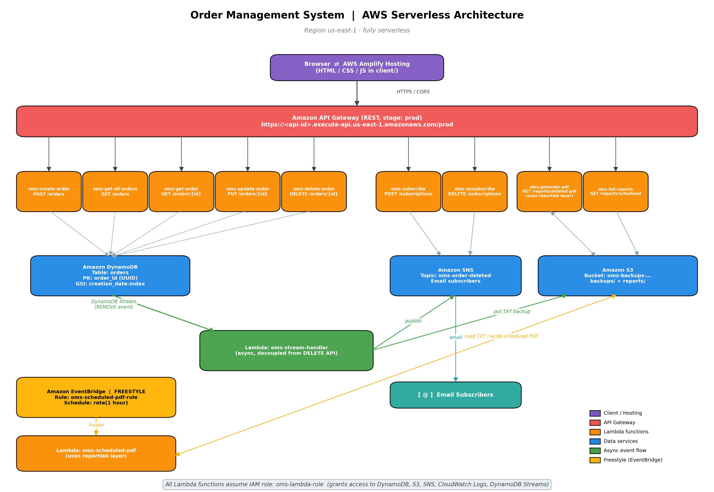
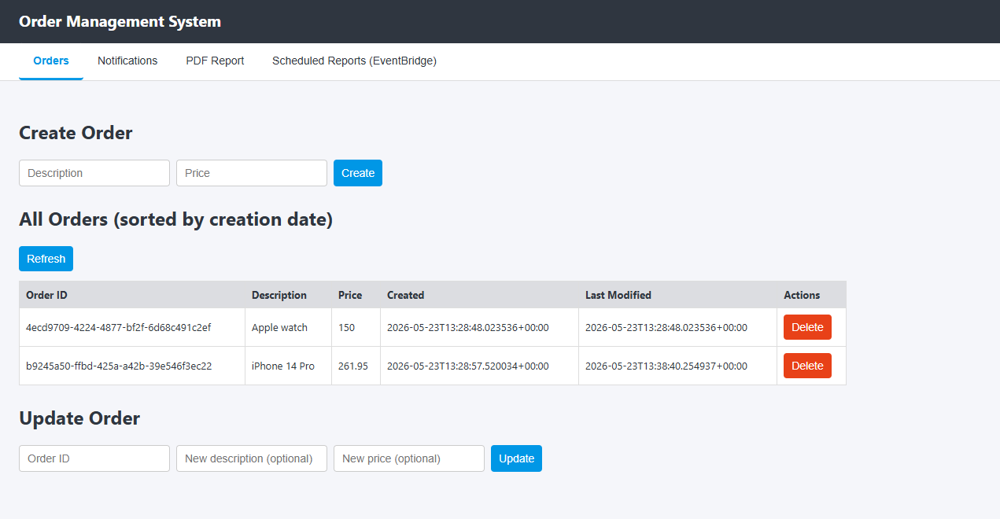
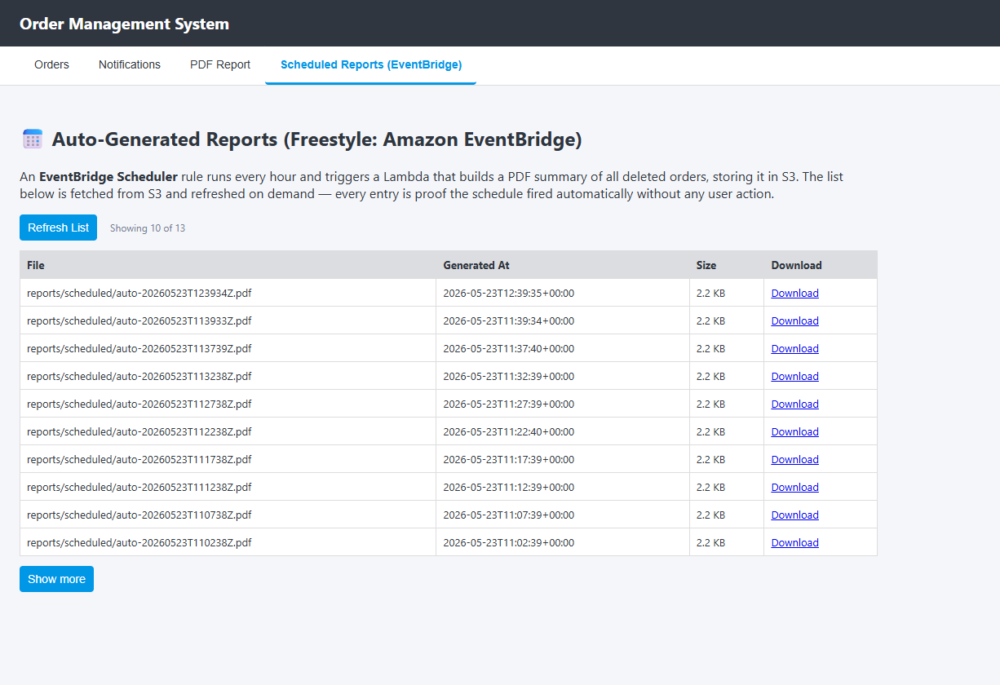

# Serverless Order Management on AWS

An event-driven order management system built entirely from managed AWS services: no servers, no containers, nothing running when nobody is using it.

A browser client talks to a REST API. Orders live in DynamoDB. Deleting an order returns immediately, and a stream-triggered worker then backs the order up to S3 and emails every subscriber. A scheduled job rebuilds a PDF report every hour.



**Stack:** Python 3.12 · AWS Lambda · API Gateway · DynamoDB (+ Streams, GSI) · S3 · SNS · EventBridge · Amplify Hosting · IAM · CloudWatch

## What it does

| Feature | How |
|---|---|
| Create, read, update, delete orders | One Lambda per route behind API Gateway |
| List all orders sorted by creation date | `Query` on a global secondary index, never a `Scan` |
| Backup on delete | DynamoDB Stream → Lambda → TXT file in S3 |
| Email on delete | Same stream handler publishes to SNS; subscribers manage themselves through the API |
| On-demand PDF of deleted orders | Lambda + `reportlab` layer, returned as a presigned S3 URL |
| Hourly PDF report | EventBridge rule → Lambda → S3, browsable from the UI |

## Screenshots

| Orders | Scheduled reports |
|---|---|
|  |  |

## Design decisions

**Deletes are asynchronous by design.** `DELETE /orders/{id}` only removes the row. The backup and the email are driven by the table's stream (`OLD_IMAGE`), so the API stays fast, and a slow mailbox or a failing backup can never fail the user's request. The stream handler ignores everything except `REMOVE` events.

**Sorted reads without a scan.** Every order carries a constant attribute `entity = "ORDER"`. The index `creation_date-index` uses it as partition key and `creation_date` as sort key, so "all orders, oldest first" is a single ordered `Query`.

**Nothing in S3 is public.** The bucket blocks all public access. PDFs and backups are downloaded through presigned URLs that expire.

**Dependencies ship as a layer.** `reportlab` (and Pillow underneath it) is packaged once as a Lambda layer and shared by both PDF functions. The layer has to be built with Linux wheels even on Windows; see [layer/](layer/).

**One function per route.** Eleven small functions instead of one router: each has its own logs, its own environment, and can be redeployed alone.

**Pay per request.** DynamoDB on-demand billing, Lambda, and API Gateway mean the system costs nothing while idle and fits inside the AWS free tier.

## API

| Method | Path | Purpose |
|---|---|---|
| `POST` | `/orders` | Create an order |
| `GET` | `/orders` | All orders, sorted by creation date |
| `GET` | `/orders/{id}` | One order |
| `PUT` | `/orders/{id}` | Update description and/or price |
| `DELETE` | `/orders/{id}` | Delete (backup + notification follow asynchronously) |
| `POST` | `/subscriptions` | Subscribe an email to deletion notifications |
| `DELETE` | `/subscriptions` | Unsubscribe |
| `GET` | `/reports/deleted-pdf` | Build a PDF of all deleted orders, return a download URL |
| `GET` | `/reports/scheduled` | List the hourly auto-generated reports |

Request and response samples are in [docs/API.md](docs/API.md).

## Repository layout

```
lambdas/     11 Python Lambda functions, one folder each
  create_order/ get_order/ get_all_orders/ update_order/ delete_order/
  subscribe/ unsubscribe/
  stream_handler/      DynamoDB Stream consumer: S3 backup + SNS publish
  generate_pdf/        on-demand PDF report
  scheduled_pdf/       hourly PDF report (EventBridge)
  list_reports/        lists scheduled reports with presigned URLs
client/      static web client (HTML, CSS, vanilla JS)
infra/       IAM trust policy and DynamoDB index definition used by the runbook
layer/       how to build the reportlab Lambda layer
docs/        deployment runbook, API reference, architecture diagram source
```

## Deploy it yourself

Everything is created with the AWS CLI; the full runbook is [docs/DEPLOY.md](docs/DEPLOY.md). In short:

1. Create the IAM role, DynamoDB table (with stream and index), S3 bucket and SNS topic.
2. Build and publish the `reportlab` layer.
3. Zip and create the 11 functions, then map the stream to `stream_handler`.
4. Create the REST API, wire each route to its function, enable CORS, deploy the `prod` stage.
5. Add the hourly EventBridge rule.
6. Put the API's invoke URL in `client/app.js` and host `client/` on Amplify (or any static host).

The original deployment has been torn down, so there is no live demo.

## What I'd change for production

- Authentication on the API (Cognito or a Lambda authorizer); the course version is open.
- Least-privilege IAM: one role per function instead of a shared role with managed full-access policies.
- Infrastructure as code (SAM or CDK) in place of the CLI runbook.
- A dead-letter queue and retry policy on the stream handler.
- Pagination on `GET /orders`.
